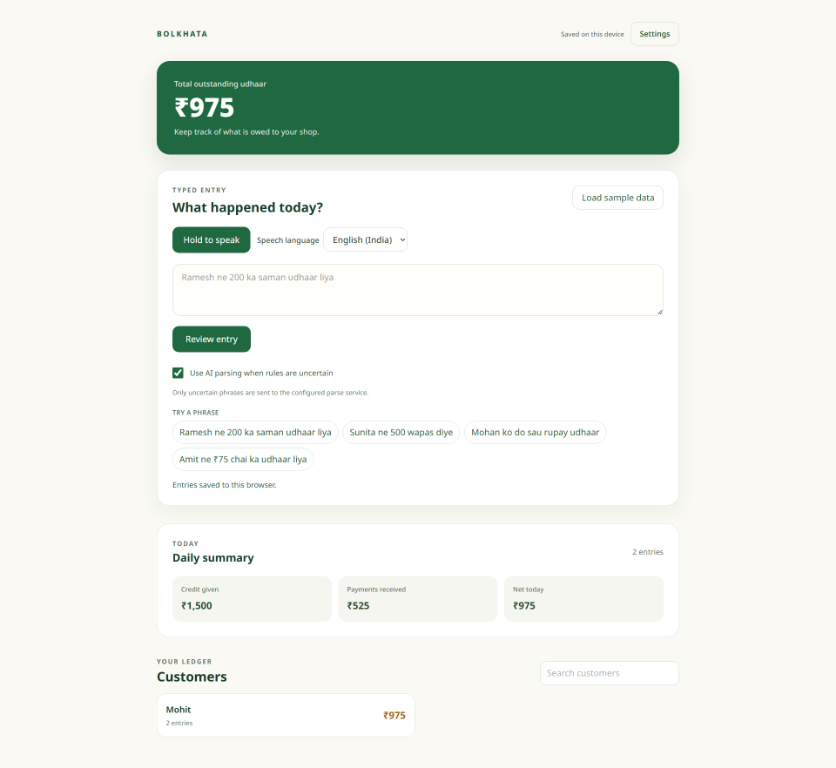
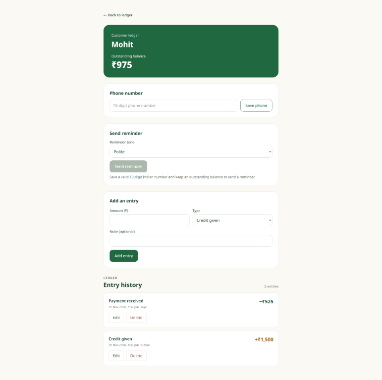
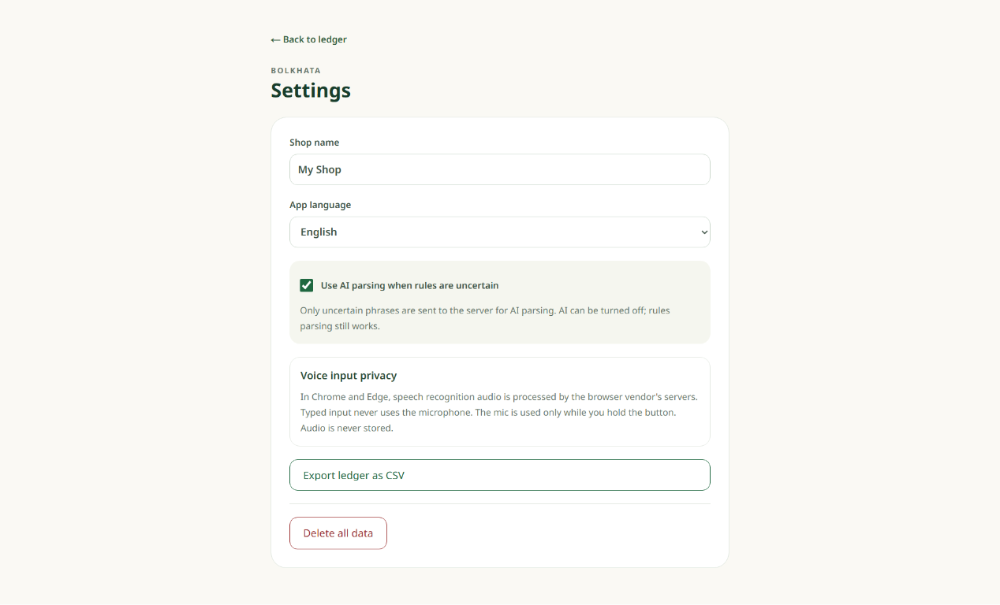

# BolKhata

BolKhata is a voice-first, browser-local udhaar ledger for small shops in India. Shopkeepers can type or speak Hindi/Hinglish transactions, review editable entries, and update customer balances. It does not handle payments or hold money.

**Live demo:** [bol-khata-ten.vercel.app](https://bol-khata-ten.vercel.app)

Built for AI Vibeathon 2026, PromptWars round.

## Screenshots

### Home ledger, voice and typed entry, and daily summary



### Customer ledger, balance, reminders, and entry history



### Settings, privacy, language, and data export



## Architecture

There are exactly two deployables, with independent npm packages and no workspaces:

- [`web/`](./web/) — Next.js App Router frontend for Vercel. The deterministic rules parser, confirmation flow, ledger, settings, and localStorage access all run in browser code. There are no Next.js API routes or Server Actions.
- [`server/`](./server/) — Node.js 20 and Express API for Render. It provides `GET /health` and `POST /api/parse`; Gemini credentials exist only on this service.

Parsing always starts with the browser rules parser. High-confidence results stay local. If an entry is uncertain and AI parsing is enabled, the browser may send the phrase to the Express API, which can ask Gemini for structured output. If AI is unavailable or returns invalid data, the rules result remains available. The shopkeeper reviews and confirms every entry before it is saved.

The shared Zod schema and `ParsedEntry` type are in [`web/src/lib/schema.ts`](./web/src/lib/schema.ts) and [`server/src/schema.ts`](./server/src/schema.ts). **Keep these files identical.**

All customer and ledger data, the shop name, language choice, and AI preference are stored in the browser's `localStorage` under one versioned key. Storage is read after the page mounts; a loading skeleton is shown until then. Invalid or corrupt stored data starts with an empty ledger. There is no database, account, or authentication. Data is not synced between devices.

## Local development

Use Node.js 20 or newer. Install and run each package separately from the repository root.

### Web

```powershell
cd web
npm install
Copy-Item .env.example .env.local
npm run dev
```

Open [http://localhost:3000](http://localhost:3000). Set `NEXT_PUBLIC_API_URL` in `web/.env.local` to the server origin to enable AI parsing; leave it blank to use browser rules only.

### Server

In a second terminal:

```powershell
cd server
npm install
Copy-Item .env.example .env
npm run dev
```

The server listens on `http://localhost:4000` by default. It runs without a Gemini key; `/health` remains available and parse requests return an empty AI result so the browser can keep its rules result. To enable AI, set `GEMINI_API_KEY` in `server/.env`. Do not put this key in the web package or expose it as a `NEXT_PUBLIC_*` variable.

### Package commands

Run commands in the corresponding package directory:

| Command | Web | Server |
|---|---|---|
| `npm run dev` | Next.js development server | Express with `tsx watch` |
| `npm run build` | Optimized Next.js build | Bundle Node 20 ESM into `dist/` |
| `npm test` | Vitest suite | Vitest suite |
| `npm run typecheck` | TypeScript check | TypeScript check |
| `npm run lint` | ESLint | — |
| `npm start` | `next start` | `node dist/index.js` |

There is no root package manager command; `web` and `server` each have their own `package.json` and lockfile.

## Ledger and demo

- Parse a typed Hindi or Hinglish phrase, edit the proposed name, amount, type, and note, then explicitly confirm before saving.
- Exact customer names (case-insensitive, normalized whitespace, honorifics removed) are preselected. A one-edit fuzzy name is only suggested; it is never preselected or merged automatically.
- Customer balances are credit given minus payments received. The home screen also shows today's credit, payments, net, and entry count.
- Customer history supports adding, editing, and deleting entries. Deletion offers a five-second undo.
- On an empty ledger, **Load sample data** creates six fictional customers. The phrase buttons exercise the typed parse-and-confirm path.
- Customer phone numbers are optional. WhatsApp reminders use a prefilled Hinglish template and do not process payments.
- CSV export prefixes formula-leading cells (`=`, `+`, `-`, and `@`) with a single quote.
- Settings include the shop name, AI preference, English/Hindi UI language, CSV export, and confirmed deletion of local data.

## Voice and privacy

Voice recognition is available only in browsers that implement the Web Speech API and requires HTTPS or `localhost`. The microphone is active only while the push-to-talk button is held. The transcript remains editable and is never saved automatically. Unsupported browsers, denied permissions, and recognition errors leave typed input available. Audio is never stored by BolKhata.

In Chrome and Edge, speech-recognition audio is processed by the browser vendor's servers. Typed input never uses the microphone. If AI parsing is enabled, only uncertain transaction text is sent to the configured Express service and then to Google Gemini; long digit sequences are removed before the Gemini request. Turn off AI parsing to keep all text parsing in the browser.

The manifest and icon support adding the site to a device's home screen. **BolKhata does not provide offline support**; no service worker is included.

## Known limitations

- Ledger data is stored only in this browser. Clearing browser data or localStorage deletes the ledger; data does not sync across devices.
- Voice recognition is available only in some browsers, requires HTTPS or localhost, and transcription accuracy varies with device, language, accent, and background noise.
- Hinglish phrases can be ambiguous. Always review and correct the suggested customer, amount, and transaction type before saving.
- BolKhata is a lightweight udhaar ledger, not accounting software. It does not provide formal bookkeeping, tax reports, reconciliation, or payment processing.
- The app has no service worker and does not work offline.

## API

- `GET /health` returns `{ "ok": true }` and does not wait on Gemini.
- `POST /api/parse` accepts JSON `{ "text": "..." }`, with text limited to 500 characters. The request body is limited to 10 KB. Invalid input gets a 400 response, and the per-IP in-memory limit is 20 requests per 10 minutes (429 when exceeded).
- Successful parser responses use `{ "source": "ai" | "none", "entries": [...] }`. Gemini failures do not surface as a 500 parse response; the API returns `source: "none"` so the browser can retain the rules result.
- Gemini calls have an 8-second per-attempt timeout, a 20-second total budget, no more than three attempts, selective retries, a final fallback model, output validation, and an in-memory SHA-256 keyed cache (one hour, bounded LRU).

## Configuration

Copy the package examples and set values for the target environment:

### `web/.env.local`

```dotenv
NEXT_PUBLIC_API_URL=https://your-render-service.onrender.com
```

Leave it blank for rules-only operation.

### `server/.env`

```dotenv
PORT=4000
FRONTEND_ORIGIN=http://localhost:3000
GEMINI_API_KEY=
GEMINI_MODEL=
GEMINI_FALLBACK_MODEL=
```

`GEMINI_API_KEY` is optional. `GEMINI_MODEL` defaults to `gemini-2.5-flash`; `GEMINI_FALLBACK_MODEL` defaults to `gemini-2.0-flash`. In production, `FRONTEND_ORIGIN` is a comma-separated allowlist of complete frontend origins (scheme and host, no path), for example `https://bolkhata.vercel.app,https://bolkhata.example.com`. `http://localhost:3000` is added automatically outside production.

## Deployment

Deploy in this order so the frontend can be configured with the server URL:

1. **Deploy `/server` to Render** as a Web Service. The included [`render.yaml`](./render.yaml) sets the root directory to `server`, build command to `npm install --include=dev && npm run build`, start command to `node dist/index.js`, and health check to `/health`. Including development dependencies ensures the `tsup` build tool is installed even though the deployed server uses `NODE_ENV=production`. Set `GEMINI_API_KEY` if AI parsing is desired; it is optional. Note the Render service URL.
2. **Deploy `/web` to Vercel** as a Next.js project with root directory `web`. Set `NEXT_PUBLIC_API_URL` to the Render URL (without a trailing slash), then deploy.
3. **Set `FRONTEND_ORIGIN` on Render** to the exact Vercel origin, such as `https://bolkhata.vercel.app`. Add any custom frontend origins as comma-separated values, then redeploy/restart the Render service.

Render's free tier sleeps after about 15 minutes idle and can take up to a minute to wake. The app still works through browser rules parsing while the service wakes. An uptime monitor pinging `/health` can keep the service warm.

## Tests

Vitest tests cover parser phrases and number words, Devanagari, splitting and honorifics, balance calculations, exact/fuzzy customer matching, local data schemas, phone normalization and reminder templates, CSV formula-injection escaping, API validation and rate limits, AI failure/repair behavior, and the client rules fallback.

Run both suites and checks from their package folders:

```powershell
cd web
npm test
npm run typecheck
npm run lint
npm run build

cd ../server
npm test
npm run typecheck
npm run build
```
